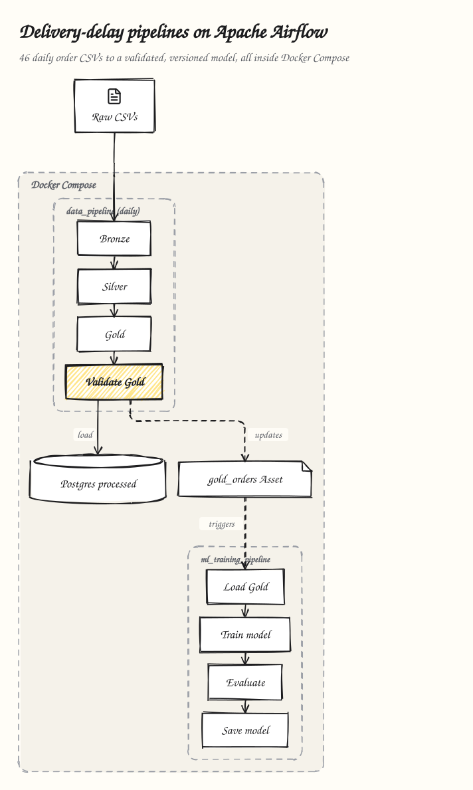
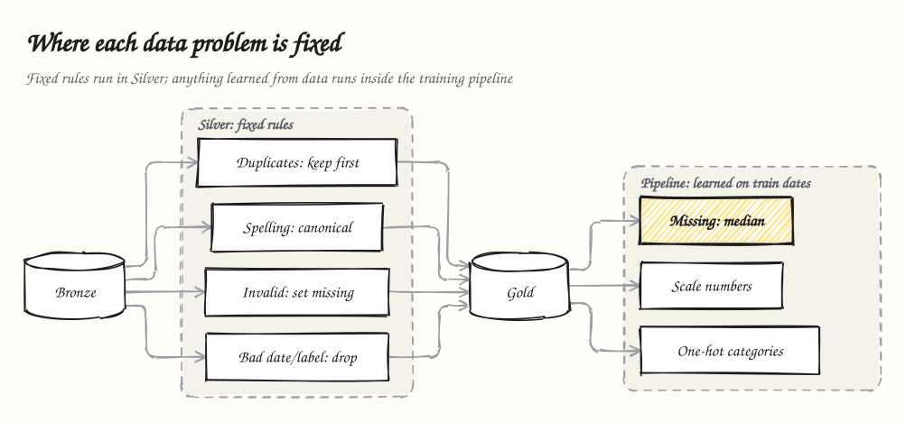
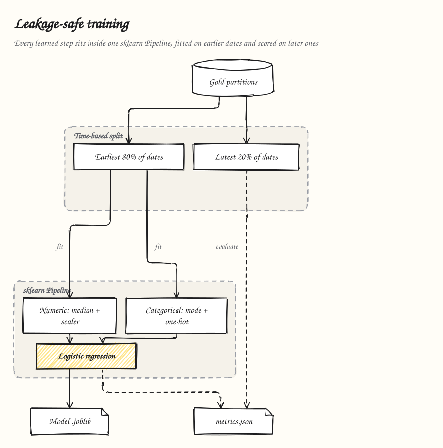
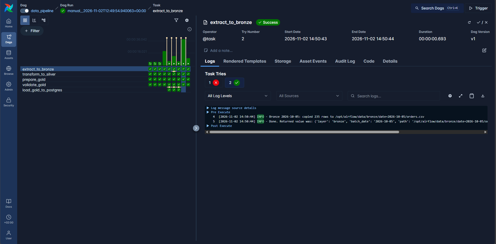
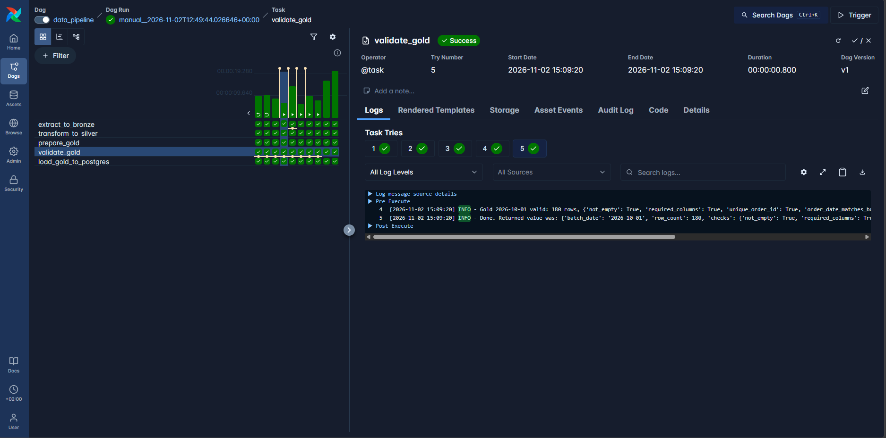
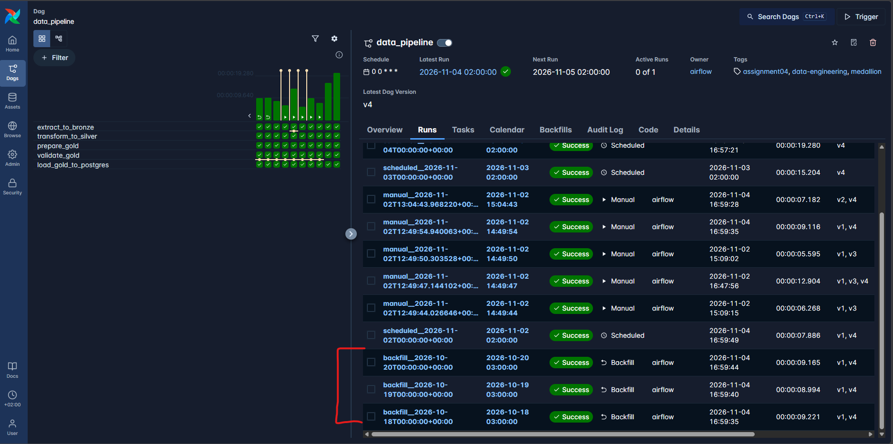

# 🚚 Daily CSVs to Automated ML Pipelines — Delivery-Delay Prediction

[](https://www.python.org/)
[](https://airflow.apache.org/)
[](https://scikit-learn.org/)
[](https://pandas.pydata.org/)
[](https://www.postgresql.org/)
[](https://docs.docker.com/compose/)
[](https://docs.astral.sh/uv/)
[](https://docs.pytest.org/)
[](https://docs.astral.sh/ruff/)
[](https://github.com/psf/black)

**Daily CSVs to Automated ML Pipelines** is a reproducible, date-aware workflow that predicts whether an Egyptian e-commerce order will be **delivered late** (`late_delivery`: 0 = on time, 1 = late). **46 daily order files** (2026-10-01 → 2026-11-15) flow through a **Bronze → Silver → Gold** medallion pipeline orchestrated by **Apache Airflow 3**. A second DAG then trains, evaluates and saves a **leakage-safe scikit-learn** model. Everything runs in **Docker Compose**.

The project is graded on engineering, not accuracy:
- every run processes exactly one dated file;
- reruns never duplicate data;
- failures retry;
- missed days can be backfilled;
- every step can be checked in the Airflow UI.

It reuses the architecture of [ML-Production_Project](https://github.com/MarwanAbdellah/ML-Production_Project):
- a frozen `Settings` dataclass read from `.env`;
- one shared logger;
- small single-purpose modules;
- uv, ruff, black and pre-commit;
- DAGs that only orchestrate plain, testable Python.

<p align="center">
  
</p>

---

## ✨ Key Features

### 🥉🥈🥇 1. Date-Partitioned Medallion Layers
- **Bronze** is a byte-for-byte copy of the day's raw CSV, so bad records and duplicates are kept.
- **Silver** deduplicates, standardises categories, casts types and turns invalid values into missing ones, using rules documented in [data/silver](data/silver/README.md).
- **Gold** holds model features plus five engineered ones, and the binary target.
- Every layer writes `data/<layer>/date=YYYY-MM-DD/orders.csv` through a temp file and an atomic rename. **Rerunning a date replaces its partition and never appends to it.**

### 🛑 2. Validation That Fails Clearly
`validate_gold` stops the run with one message that lists every failed check:
- an empty partition;
- missing columns;
- duplicate `order_id`;
- an `order_date` that differs from the batch date;
- a label outside {0, 1}.

Training is never triggered from invalid data.

### 🌀 3. Two Airflow 3 DAGs
- **`data_pipeline`** (`@daily`): `extract_to_bronze → transform_to_silver → prepare_gold → validate_gold → load_gold_to_postgres`. The batch date is the run's **logical date**.
- **`ml_training_pipeline`**: `load_gold_data → train_model → evaluate_model → save_model`. It starts automatically whenever valid Gold lands, and can also be triggered manually.
- Both DAGs use `retries=2` and a 30 s `retry_delay`. XCom carries only small summaries; data and models move through files.

### 🛡️ 4. Leakage-Safe Training
- **Time-based split**: the earliest 80 % of Gold dates train the model, and the latest 20 % test it. The model never learns from the future.
- Imputation, scaling and one-hot encoding all live inside **one sklearn `Pipeline`** fitted on training rows only. A test checks that the imputer's medians equal the training-set medians.
- `LogisticRegression(class_weight="balanced")` handles the 76 / 24 class imbalance.

### 🔁 5. Reliability You Can See
Safe retry evidence comes from `SIMULATE_FAILURE_DATES`, which makes the first attempt fail. This table shows the result of each check:

| Check | Result |
|---|---|
| Retry | Attempt 1 failed, attempt 2 succeeded |
| Same-date rerun | Identical checksums and row counts |
| Three-date backfill | 2026-10-18 → 20 processed |

### ⚙️ 6. Config-Driven and Typed
- Every setting lives in one frozen `Settings` dataclass ([src/config.py](src/config.py)), so nothing is hardcoded.
- Layer contracts and step results are typed dataclasses: `BatchPaths`, `LayerResult`, `ValidationReport`, `SplitInfo`, `TrainingMetrics`, `ModelReport`.

### 🎁 7. Optional Bonus Work (all merged)
Each bonus was built on its own branch and merged through a pull request:

| Bonus | Pull request |
|---|---|
| 🧪 **ETL + training tests**: 25 pytest tests, including DAG integrity | [#1](https://github.com/MarwanAbdellah/Daily-CSVs-to-Automated-ML-Pipelines/pull/1) |
| ⚡ **Auto-trigger**: the `gold_orders` Airflow Asset schedules ML training | [#2](https://github.com/MarwanAbdellah/Daily-CSVs-to-Automated-ML-Pipelines/pull/2) |
| 🏷️ **Model versioning**: `models/versions/<UTC timestamp>/` per run | [#3](https://github.com/MarwanAbdellah/Daily-CSVs-to-Automated-ML-Pipelines/pull/3) |
| 🐘 **PostgreSQL**: Gold loaded idempotently into a `processed` database | [#4](https://github.com/MarwanAbdellah/Daily-CSVs-to-Automated-ML-Pipelines/pull/4) |

---

## 📖 Stage A — Exploring the Data

46 files `data/raw/orders_YYYY-MM-DD.csv` hold **10,219 rows** in total. They share 15 columns, documented in [data_dictionary.csv](data_dictionary.csv).

| Kind | Columns |
|------|---------|
| Identifier / date | `order_id`, `order_date` (equals the file's batch date) |
| Categorical | `customer_region`, `warehouse_id`, `shipping_method`, `weather_risk_level` |
| Numeric | `order_hour`, `distance_km`, `items_count`, `package_weight_kg`, `order_value_egp`, `promised_delivery_days`, `warehouse_load_pct`, `carrier_on_time_rate` |
| Label | `late_delivery` (binary) |

Three dated batches were inspected in pandas, then the whole dataset. The full analysis, with charts, is in [notebooks/01_eda.ipynb](notebooks/01_eda.ipynb).

| Batch | Rows | Duplicate IDs | Missing values | Invalid values | Non-canonical `shipping_method` | Late % |
|-------|------|---------------|----------------|----------------|---------------------------------|--------|
| 2026-10-01 | 183 | 3 | distance 3, warehouse_load 4, weather 2 | distance ≤ 0: 1, items = 0: 2 | 3 | 24.6 |
| 2026-10-02 | 196 | 3 | shipping 1, distance 3, weather 1, carrier_rate 1 | order_value ≤ 0: 2, items = 0: 1 | 3 | 20.9 |
| 2026-10-03 | 209 | 3 | shipping 1, distance 1, warehouse_load 3, weather 1, carrier_rate 2 | distance ≤ 0: 3 | 1 | 21.5 |
| **All 46** | **10,219** | **166** | shipping 74, distance 142, warehouse_load 149, weather 94, carrier_rate 87 | distance ≤ 0: 81, order_value ≤ 0: 55, items = 0: 98 | 288 (` standard `, `EXPRESS`, `same_day`) | **23.7** |

- Every duplicate is an exact copy of another row.
- All labels are valid 0/1, and every `order_date` matches its file's date.
- The classes are imbalanced, about 76 / 24.
- The late rate **drifts upward from 2026-11-06** (25–34 % vs mostly 20–25 % in October). That is why the train/test split is by date.
- The strongest signals are warehouse load, short delivery promises, high weather risk and Same_Day shipping. Every single-feature correlation is weak (|r| ≤ 0.18).

---

## 🧹 Data-Quality Rules: Silver vs. Training

<p align="center">
  
</p>

A rule that gives the same answer whatever data comes later belongs in **Silver**. Anything *learned from data* belongs in the **training pipeline**: computing it on all data would leak information from the test dates.

| Problem | Fixed in | How |
|---------|----------|-----|
| Duplicate `order_id` | **Silver** | Keep the first row |
| Category spelling (`EXPRESS`, ` standard `) | **Silver** | Map to the canonical value |
| Missing or unknown category | **Silver** | Explicit `Unknown` level |
| Out-of-range numbers (≤ 0 distance/value, 0 items, rate ∉ [0, 1] …) | **Silver** | Set to missing |
| Unparseable or wrong date, label ∉ {0, 1} | **Silver** | Drop the row, and count it |
| Missing numeric values | **Training pipeline** | `SimpleImputer(median)`, fitted on training dates |
| Scaling, one-hot encoding | **Training pipeline** | `StandardScaler`, `OneHotEncoder(handle_unknown="ignore")` |

**Gold engineered features** are row-wise only, so each day can be computed on its own:

| Feature | Meaning |
|---|---|
| `day_of_week` | 0 = Monday … 6 = Sunday |
| `is_weekend` | Friday or Saturday (the Egyptian weekend) |
| `is_after_cutoff` | Ordered at or after 18:00, so it usually ships the next day |
| `weight_per_item` | Package weight divided by the number of items |
| `distance_per_promised_day` | How tight the delivery promise is |

---

## 🏗️ ML Pipeline Architecture

<p align="center">
  
</p>

1. **`load_gold_data`** concatenates every validated Gold partition into `data/ml/gold_combined.csv`. It fails if an `order_id` appears in two partitions.
2. **`train_model`** makes the time-based split and fits the full pipeline on the training dates. It saves a candidate model and `split.json`.
3. **`evaluate_model`** scores the candidate on the held-out later dates.
4. **`save_model`** publishes three artifacts:
   - `models/delivery_delay_model.joblib`;
   - `metrics/metrics.json`;
   - an immutable `models/versions/<UTC timestamp>/` copy.

   It then reloads the published model and checks that it reproduces the evaluated predictions.

---

## 📊 Evaluation Results

The current model is `v20261104T150003Z`, retrained automatically when the 2026-11-04 Gold partition landed. Of the 11 Gold dates, it was trained on 9 (1,854 rows) and tested on the 2 latest, 2026-11-03 and 2026-11-04 (451 rows):

| Metric | Value |
|--------|-------|
| **Accuracy** | **0.6497** |
| Precision (late) | 0.2989 |
| **Recall (late)** | **0.5909** |
| F1 (late) | 0.3969 |

Confusion matrix (`[[TN, FP], [FN, TP]]`):

```
[[241 122]
 [ 36  52]]
```

The balanced class weights trade precision for recall: the model catches **about 59 % of late deliveries** at the cost of false alarms. That is the right trade-off when a missed late order costs more than a proactive customer notice. The full report, with split dates, late rates and feature lists, is in [metrics/metrics.json](metrics/metrics.json).

---

## 🛠️ Technology Stack

### Orchestration & Infrastructure
- **Apache Airflow 3.3.2**: TaskFlow DAGs, Assets, backfills, LocalExecutor
- **Docker Compose**: Postgres 16, Airflow API server/UI, scheduler, DAG processor and triggerer
- **PostgreSQL 16**: Airflow metadata and the `processed` database for Gold

### Data & ML
- **pandas 3.0**: the ETL layers
- **scikit-learn 1.9**: `ColumnTransformer`, `SimpleImputer`, `StandardScaler`, `OneHotEncoder`, `LogisticRegression`
- **joblib**: model artifacts
- **SQLAlchemy + psycopg2**: loading Gold into Postgres

### Environment & Quality
- **Python 3.12** (the Airflow image's Python)
- **uv** for the local environment (`uv.lock` committed)
- **Ruff**, **Black** and **pre-commit**
- **pytest** (25 tests)

### Exploration (notebook only: `uv sync --group experiments`)
- Jupyter / ipykernel, nbconvert, Matplotlib and Seaborn for [notebooks/01_eda.ipynb](notebooks/01_eda.ipynb)
- None of these are installed in the Airflow image or imported by `src/` or `dags/`

### Diagrams
- Hand-drawn diagrams made with [Sketchy](https://github.com/ddkbs/sketchy). Sources are in [docs/diagrams](docs/README.md).

---

## 🚀 Getting Started

### Prerequisites
- **Docker Desktop**, with at least 4 GB of memory for Docker
- **Git**
- *(optional)* **[uv](https://docs.astral.sh/uv/)**, to run the pipelines or tests without Airflow

### 1. Clone and start Airflow
```bash
git clone https://github.com/MarwanAbdellah/Daily-CSVs-to-Automated-ML-Pipelines.git
cd Daily-CSVs-to-Automated-ML-Pipelines
docker compose up -d --build
```
The first start builds the image and takes a few minutes. A `.env` file is optional because every setting has a working default. Copy it to change settings:
```bash
cp .env.example .env
```

| Variable | Default | Purpose |
|----------|---------|---------|
| `_AIRFLOW_WWW_USER_USERNAME` / `_PASSWORD` | `airflow` / `airflow` | UI login |
| `AIRFLOW_UID` | `50000` | Linux: set to `id -u` so mounted files stay yours |
| `LOG_LEVEL` | `INFO` | Logging verbosity |
| `TEST_FRACTION` | `0.2` | Share of the latest Gold dates held out for testing |
| `RANDOM_STATE` | `42` | Model seed |
| `SIMULATE_FAILURE_DATES` | *(empty)* | Comma-separated dates whose first attempt fails (retry demo) |
| `PROCESSED_DB_URI` | set by compose | Postgres target for Gold; empty skips the load |
| `POSTGRES_HOST_PORT` | `5432` | Host port for connecting to Postgres from pgAdmin, DBeaver or psql |

### 2. Open the UI and unpause both DAGs
Open <http://localhost:8080> and log in as `airflow` / `airflow`. DAGs start **paused**. Unpause both, with the UI toggles or:
```bash
docker compose exec airflow-scheduler airflow dags unpause data_pipeline
docker compose exec airflow-scheduler airflow dags unpause ml_training_pipeline
```
`ml_training_pipeline` must be unpaused for the automatic trigger to work. If today falls inside the 2026-10-01 → 2026-11-15 window, unpausing `data_pipeline` also creates one scheduled run for today.

### 3. Run dated batches
```bash
docker compose exec airflow-scheduler airflow dags trigger data_pipeline --logical-date 2026-10-01T00:00:00+00:00
```
Repeat this for 2026-10-02 and 2026-10-03, or choose a logical date in the UI's **Trigger** dialog. Each valid Gold partition starts `ml_training_pipeline` on its own. You can also trigger training directly:
```bash
docker compose exec airflow-scheduler airflow dags trigger ml_training_pipeline
```

### 4. Inspect the outputs
- Layers: `data/bronze|silver|gold/date=YYYY-MM-DD/orders.csv`
- Model and metrics: `models/delivery_delay_model.joblib`, `metrics/metrics.json`, `models/versions/`
- Processed database: from inside Docker, run
```bash
docker compose exec postgres psql -U airflow -d processed -c "SELECT order_date, COUNT(*) FROM gold_orders GROUP BY 1 ORDER BY 1"
```
  You can also use any client on your machine (pgAdmin, DBeaver, psql):

  | Setting | Value |
  |---|---|
  | Host / port | `localhost` / `5432` (change it with `POSTGRES_HOST_PORT` if a local PostgreSQL already uses 5432) |
  | Database | `processed` |
  | User / password | `airflow` / `airflow` |
  | Table | `gold_orders` |

  The table holds every date that `data_pipeline` has run since the database was created. Each date's row count equals its Gold file's row count.

### 5. Without Airflow (optional)
```bash
uv sync
uv run python run.py etl --date 2026-10-01 --date 2026-10-02 --date 2026-10-03
uv run python run.py train
```

---

## 🧪 Testing & Verification

### Automated
```bash
uv run pytest                                                                   # 21 ETL + training tests
docker compose exec airflow-scheduler python -m pytest -p no:cacheprovider tests # all 25, including DAG integrity
```
The suite covers the Silver rules, every Gold validation failure, byte-identical same-date reruns, the time split, leakage-safe preprocessing, and the DAG task order and retries. See [tests/README.md](tests/README.md).

### Reliability checks (all run for this repository)

| Check | How | Expected |
|-------|-----|----------|
| **Retry** | Set `SIMULATE_FAILURE_DATES=2026-10-05` in `.env`, run `docker compose up -d`, then trigger that date | `extract_to_bronze` attempt 1 fails with *Simulated transient failure*; attempt 2 succeeds |
| **Same-date rerun** | Run `airflow tasks clear data_pipeline -s 2026-10-01 -e 2026-10-01 -y` twice | Identical Bronze/Silver/Gold checksums, 180 Gold rows, no duplicate `order_id`s, unchanged Postgres counts |
| **Backfill** | `airflow backfill create --dag-id data_pipeline --from-date 2026-10-18 --to-date 2026-10-20` | `gold/date=2026-10-18`, `-19` and `-20` |
| **Auto-trigger** | Any successful `data_pipeline` run | An `asset_triggered__…` run of `ml_training_pipeline` |
| **Monitoring** | Graph view, task tries and logs in the UI | Raw task logs are also in `logs/` |

All evidence screenshots are in [screenshots/](screenshots/README.md). Three key ones:

| Retry (try 1 ✗, try 2 ✓) | Same-date rerun (5 tries, same rows) | Backfill (3 dates) |
|---|---|---|
|  |  |  |

---

## 📁 Project Structure

```text
Daily-CSVs-to-Automated-ML-Pipelines/
├── dags/
│   ├── data_pipeline.py            # Daily: Bronze → Silver → Gold → validate → Postgres
│   └── ml_training_pipeline.py     # Asset-triggered: load → train → evaluate → save
├── src/                            # Airflow-free, reusable modules (source of truth)
│   ├── config.py                   # Frozen Settings dataclass from .env
│   ├── logging_config.py           # One shared logging setup
│   ├── schemas.py                  # Column contracts, Silver rules, step dataclasses
│   ├── etl.py                      # Bronze / Silver / Gold / validation per date
│   ├── train.py                    # Load Gold, time split, Pipeline, metrics, save
│   └── db.py                       # Idempotent Gold load into Postgres
├── tests/                          # 25 pytest tests (ETL, training, DAG integrity)
├── notebooks/
│   └── 01_eda.ipynb                # Stage A: EDA of 3 dated batches + all 46 files
├── data/
│   ├── raw/                        # 46 source CSVs, never modified
│   ├── bronze/ silver/ gold/       # date=YYYY-MM-DD/orders.csv partitions
│   └── ml/                         # Training hand-off files (git-ignored)
├── models/                         # delivery_delay_model.joblib + versions/
├── metrics/                        # metrics.json
├── screenshots/                    # Airflow UI evidence
├── docs/diagrams/                  # Sketchy diagram sources + SVGs
├── Dockerfile                      # Airflow 3.3.2 image + pinned requirements
├── docker-compose.yml              # Postgres + Airflow services, bind mounts
├── requirements.txt                # Runtime deps for the Airflow image
├── pyproject.toml / uv.lock        # Local environment, ruff + black config
├── run.py                          # CLI: etl --date … | train
├── data_dictionary.csv             # Column definitions and validation notes
└── .env.example                    # Every setting, documented
```

Every folder has its own `README.md` that explains its modules and files.

---

## 👤 Author

**Marwan Abdellah**
- **GitHub**: [@MarwanAbdellah](https://github.com/MarwanAbdellah)
- **LinkedIn**: [Marwan Abdellah](https://www.linkedin.com/in/marwan-abdellah/)
